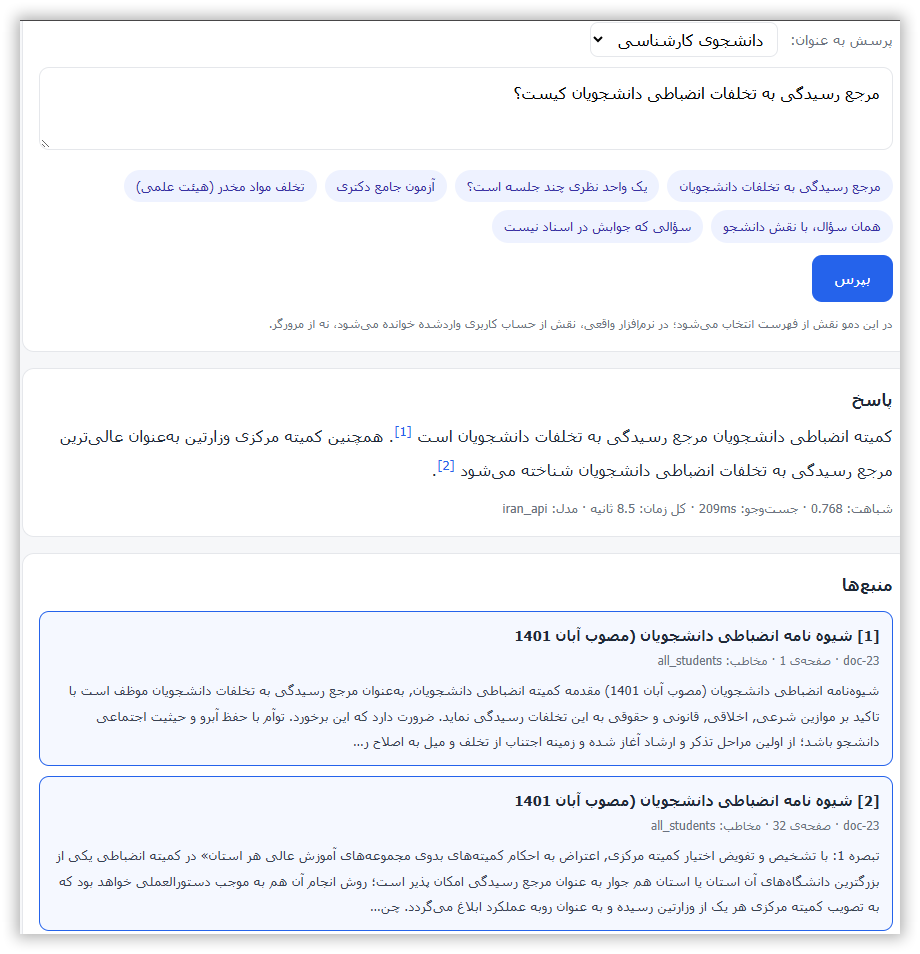
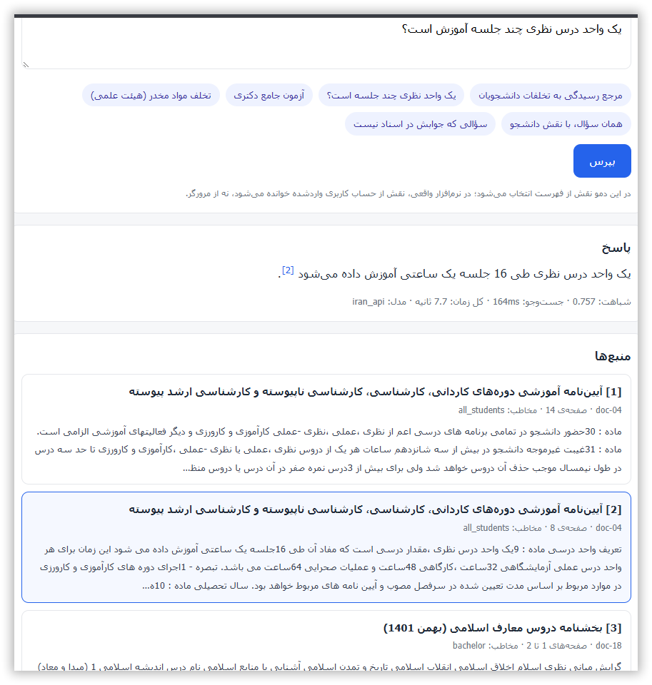

# Laravel Persian RAG — Web Demo

A small Laravel app that shows [laravel-persian-rag](https://github.com/js199069/laravel-persian-rag) in a browser: sources appear in under a second, the answer streams in, and every citation links to the document and page it came from.

> یک برنامه‌ی کوچک لاراول که پکیج laravel-persian-rag را در مرورگر نشان می‌دهد: منبع‌ها زیر یک ثانیه، جواب به‌صورت استریم، و هر ارجاع با لینک به سند و صفحه.

<!-- Add a screenshot: docs/screenshot.png -->
<!-- Add the silent demo video link here -->

## What it shows

- **Sources first, then the answer.** Search results appear immediately; the answer streams word by word.
- **Clickable citations.** `[2]` jumps to source 2; cited sources are highlighted.
- **Role switching.** Ask the same question as a student and as faculty, and see different documents.
- **Honest refusals.** An on-topic question whose answer isn't in the documents gets "not found", not an invented answer.
- **Readable errors.** If Ollama is down, the page says so instead of showing a generic 500.

> **The role is chosen from a dropdown for demonstration only.** In a real application it must come from the authenticated user — otherwise anyone can claim any role.

## Setup

The demo uses the package from a sibling folder, so clone both repositories side by side:

```bash
git clone https://github.com/js199069/laravel-persian-rag.git
git clone https://github.com/js199069/laravel-persian-rag-demo.git
cd laravel-persian-rag-demo

composer install
cp .env.example .env
php artisan key:generate
```

In `.env`, set the PostgreSQL connection (`DB_CONNECTION=pgsql`, ...) and:

```ini
OLLAMA_URL=http://localhost:11434/v1
OLLAMA_CHAT_MODEL=qwen2.5:3b
OLLAMA_EMBED_MODEL=bge-m3

IRAN_API_URL=https://your-openai-compatible-endpoint/v1
IRAN_API_KEY=...
IRAN_API_CHAT_MODEL=...

RAG_LLM_PROVIDER=iran_api
```

(`iran_api` is just the provider name used in this demo's `config/ai.php`; any OpenAI-compatible endpoint works.)

Then enable pgvector on the database (once, as a superuser: `CREATE EXTENSION vector;`) and:

```bash
php artisan migrate
php artisan rag:health --llm
```

Everything except "index is empty" should be green. See the [package README](https://github.com/js199069/laravel-persian-rag#installation) for details on each step.

## Documents

The original demo runs on 31 regulations from an Iranian university. **Those documents are not included.** Use the package's fictional sample corpus instead:

```bash
mkdir -p storage/app/corpus
cp ../laravel-persian-rag/examples/sample-corpus/{*.pdf,*.docx,manifest.csv} storage/app/corpus/

php artisan rag:extract
php artisan rag:quality
php artisan rag:refine
php artisan rag:index --fresh
php artisan serve
```

Open http://127.0.0.1:8000.

> The example buttons on the page were written for the original university documents. With the sample corpus, type your own questions — for example:
> - «یک واحد درس نظری چند جلسه است؟» (as a bachelor student)
> - «مهلت اعتراض به رأی کمیته انضباطی چقدر است؟» (answered from a **scanned** document)
> - «مصرف مواد مخدر توسط عضو هیئت علمی چه نوع تخلفی است؟» — once as faculty, once as a bachelor student
> - «حقوق اعضای هیئت علمی چه روزی پرداخت می‌شود؟» (not in the documents — should be refused)

## Where to look in the code

| File | What it does |
|---|---|
| `app/Http/Controllers/RagDemoController.php` | `search` returns sources as JSON; `answer` streams the answer. Both use the package's `Rag` class. |
| `resources/views/rag-demo.blade.php` | One Blade file, no build step: fetch for sources, `EventSource` for streaming, citation highlighting. |
| `routes/web.php` | `/`, `/rag/search`, `/rag/answer` |
| `config/persian-rag.php` | Roles, threshold, and other package settings |

## License

MIT.


